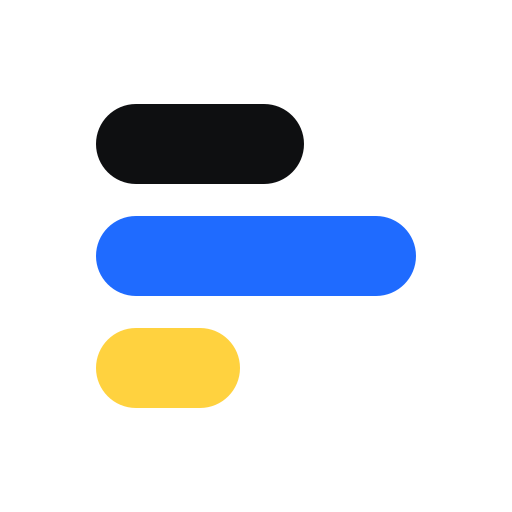
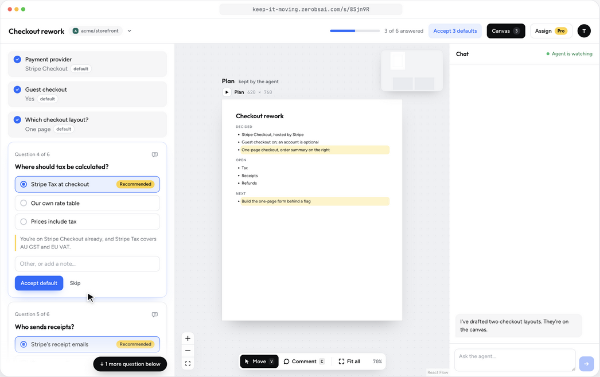

<p align="center">
  
</p>

<h1 align="center">Keep it moving</h1>

<p align="center">
  <b>Your agent asks. You answer in one click.</b><br>
  When your coding agent needs decisions from you, it opens an interview in your browser,<br>
  with its recommended answer already picked and a plan that updates as you go.
</p>

<p align="center">
  <a href="https://keep-it-moving.zerobsai.com">Website</a> ·
  <a href="#use-it">Install</a> ·
  <a href="#deploy-your-own">Run your own</a> ·
  <a href="LICENSE">FSL-1.1-MIT</a>
</p>

<p align="center">
  
</p>

## Why

Coding agents stall on decisions, and a terminal is a bad place to make them. Keep it moving gives your agent a proper place to ask:

- **Recommended answers.** Every question comes with the agent's pick and its reasoning, already selected. Agree with all of them in one click, or change the ones you disagree with.
- **A plan that keeps up.** The agent rewrites the plan after each batch of answers, beside the questions, with diagrams and HTML mockups you can click through and comment on.
- **System designs that land in your PR.** Work through the data model, architecture, flows and API with your agent, starting from what's in your repo's `.kim/` folder. Changes are highlighted against main, and what you keep is written back for review with the code.
- **Every agent you use.** Claude Code, Codex, Cursor, Gemini CLI, Copilot and 11 more, from one skill that kim keeps up to date.
- **Send it to someone else.** Assign an interview to a client or colleague by email; their answers go straight back to your agent.
- **Yours to run.** A Cloudflare Worker, the `kim` CLI and the skill, all here. Use the hosted version, or deploy your own.

Quick start (Node.js 22.13 or newer):

```sh
npm install -g https://keep-it-moving.zerobsai.com/cli.tgz
kim skill install
kim login
```

Then ask your agent to "interview me about this feature".

## About

Keep it moving (formerly Interviewer) runs interviews between agents and people: an agent asks questions in the browser, beside a living plan, diagrams and mockups, and waits for the answers; the person answers, chats with the agent, or hands the interview to someone else. The home page lists every interview and what's left to do on it. It's hosted on a Cloudflare Worker at https://keep-it-moving.zerobsai.com. The CLI is `kim`; `interviewer` is the same command, kept so older scripts still work.

## Use it

You need Node.js 22.13 or newer and a Google account.

```sh
npm install -g https://keep-it-moving.zerobsai.com/cli.tgz
kim skill install
kim login
```

`skill install` asks which agents get the interviewer skill: Claude Code, Codex, Pi, Cursor, Gemini CLI, GitHub Copilot, OpenCode, Amp, Factory Droid, Windsurf, Antigravity, Goose, Kiro CLI, Roo Code, Kilo Code or Qwen Code, with the ones on this machine listed first and ticked. Agents that read `~/.agents/skills` themselves, such as Cline, Warp and Zed, get it without being picked. Then ask Claude to interview you about something, such as "interview me about this feature", and answer in the browser. Diagrams also need the [archify](https://github.com/tt-a1i/archify) skill.

The skill lives in `~/.agents/skills/interviewer`, a copy kim made (marked by `.installed-by-kim`), and each chosen agent's skills folder links to it. Every `kim` run refreshes that copy when the CLI's bundled skill has changed, so the agents stay current. Outside a terminal, pick agents with `--agents claude,codex,cursor` (`kim skill agents` lists the ids and folders) or `--all` for every agent found on the machine; without either it uses the last choice, or Claude Code. It never replaces a link or folder it didn't make, such as a dev checkout's links, unless `--force`. `kim skill uninstall` removes what it made.

For Claude Code and Codex, kim also installs its agent hooks, and keeps them current the way it keeps the skill copy current: `skill install`, `skill refresh`, `kim update` and every other `kim` run make sure each chosen agent that has hooks has kim's entries, rewriting them when their definition changes (kim records a hash of the entries per hooks file in `hooks-install.json` in its config folder, so a run with nothing to do reads one small file). It never installs them for an agent you didn't choose for the skill, never fails or slows a command over them, and leaves a hooks file it can't parse as it is. To opt out, `kim hooks uninstall` (or `skill install --no-hooks`): runs then leave them out until `kim hooks install` opts back in. `kim hooks status` says which events have them, and `--agents claude,codex` picks agents for `hooks install`. [Answers while the agent works](#answers-while-the-agent-works) has how they work.

kim keeps itself up to date. Every six hours a `kim` run checks the site's `/cli-version.json` (the build `npm run pack:cli` stamped into the package, a static file), and when a newer build is out it says so in one line on stderr and runs `kim update` detached in the background, logging to `update.log` in kim's config folder (one at a time, under `update.lock` there). The next run refreshes the skill copy and hooks from the new CLI, as every run does. A hook can start the check too, but leaves it to a detached `kim` so the agent never waits on it. kim doesn't update itself when `KEEP_IT_MOVING_NO_AUTO_UPDATE=1`, or when it runs from a git checkout (a dev `npm link`): then, or when the install fails (npm without write access to its global folder, say), it says `kim update available: run kim update` instead. `kim update` reinstalls the CLI from the site and refreshes the skill and hooks.

The code is at https://github.com/timoconnellaus/keep-it-moving. Sign in at https://keep-it-moving.zerobsai.com and use it as is, or deploy your own copy.

## Deploy your own

The license is the [Functional Source License](LICENSE) (FSL-1.1-MIT): use it, change it and run your own copy for yourself or your company, but don't sell it, or a service built on it, as a competing product. Each version becomes MIT two years after it's released.

You need a Cloudflare account with a domain on it, and a Google Cloud project for the sign-in.

1. In `wrangler.jsonc`, set `account_id` to yours, `routes` to your domain, and `PUBLIC_URL` to its origin. Create a KV namespace (`npx wrangler kv namespace create OAUTH_KV`) and put its id in `kv_namespaces`.
2. Create the Google OAuth client and set its secrets, as in [Sign-in and secrets](#sign-in-and-secrets). Leave `OWNER_EMAIL` out.
3. For phone notifications, generate a VAPID key pair: put the public key in `VAPID_PUBLIC_KEY` and the private JWK in the `VAPID_PRIVATE_JWK` secret. Without them, notifications are off.
4. `npm install && npm run deploy`.

Your deployment serves its own CLI at `<your origin>/cli.tgz`. The CLI talks to keep-it-moving.zerobsai.com unless told otherwise, so set `KEEP_IT_MOVING_URL=<your origin>` in your shell profile before `kim login`.

## Develop

```sh
npm install
npm run link:dev        # builds the CLI and links the `interviewer` executable
npm run setup:agents    # links the skill to this checkout and adds the /grill-me pointer
kim login       # browser sign-in: Google, then OAuth back to the CLI
```

`login` stores a refresh token in the user config directory (readable only by you), keyed by service URL. `kim whoami` checks it and `kim logout` forgets it. Set `KEEP_IT_MOVING_URL` to point the CLI at another deployment, such as `wrangler dev` on `http://localhost:8787`.

Deploy with `npm run deploy`, which builds the web client and runs `wrangler deploy`.

For local development, put `DEV_EMAIL=<your email>` and `PUBLIC_URL=http://localhost` in `.dev.vars` and run `npx wrangler dev --local --host localhost` (`.claude/launch.json` has it as `worker`). `--host localhost` keeps requests on localhost, where `DEV_EMAIL` stands in for Google sign-in. To try the real sign-in locally instead, leave `DEV_EMAIL` out, put `GOOGLE_CLIENT_SECRET` in `.dev.vars`, and add `http://localhost:8787/auth/google/callback` to the OAuth client's redirect URIs.

### Sign-in and secrets

The browser signs in with Google; anyone with a Google account can, and each user gets a private workspace of their own. Signed out, the site root shows the marketing page, built from `docs/marketing/keep-it-moving.html` (see `docs/marketing/demo/README.md`); signed in, it's the app. The Worker runs the sign-in itself (OpenID Connect with PKCE, checking Google's ID token and its verified email), so it needs a Google OAuth client:

1. In Google Cloud Console, create an OAuth client of type **Web application** with the redirect URI `https://keep-it-moving.zerobsai.com/auth/google/callback` (that is, `PUBLIC_URL` + `/auth/google/callback`).
2. Run `npx wrangler secret put GOOGLE_CLIENT_ID` and paste its client ID.
3. Run `npx wrangler secret put GOOGLE_CLIENT_SECRET` and paste its secret.

`ADMIN_EMAILS`, a comma-separated secret, says who may open `/admin`: a list of everyone who has signed in, with when they were first and last seen (to the day). Anyone else gets a 404 there, and without the secret nobody does.

The optional `OWNER_EMAIL` secret (`npx wrangler secret put OWNER_EMAIL`) names the deployment's owner: their workspace is the one from before there were other users. Leave it out on a new deployment. These stay out of `wrangler.jsonc` so a copy of the repo doesn't deploy with someone else's.

### Assigning an interview to someone else

An interview can be assigned to someone else's email, for them to answer: `kim session create … --assign <email>`, `kim session assign <session> <email>` (or `--clear`), or **Assign** on the interview page. Send them the interview's link yourself; nothing is emailed. They sign in with Google as that email and see only that interview (its questions, the workspace items on stage, and the chat) under "From <you>"; any other account gets a page naming the masked address it was sent to, with **Switch account** and a way to link that address ([Linked accounts](#linked-accounts)). Their answers and messages carry their email (`answeredBy` and `from` in `wait` batches, "by …" on the page), wake the waiting agent as yours do, and push to your devices once per burst. While it's assigned, its open questions wait on them, not you: the home page and the switcher say "Waiting on …". Their own home page lists it under **Shared with you**, from you.

The interview stays in the owner's workspace. The Worker keeps a directory in `OAUTH_KV` (`share:<token>` → owner and assignee, `assigned:<email>:<token>` for the list) to route the assignee there, marked with a header only the Worker sets; the owner's hub then allows that header on the one interview's page routes only, and only while the interview is still assigned to that email, so clearing the assignment locks them out at once, before KV catches up. Deleting the interview removes the entries.

### Answering with your agent

An interview sent to you can also be worked on by your own agent, signed in to `kim` as you (or as an account linked to yours; agent keys can't):

```sh
kim inbox                                    # sent to you and still open: id, url, sender, open and drafted counts
kim inbox show <interview>                   # questions with answers, drafts and chat threads; the chat; the workspace
kim inbox artifact <interview> <artifact> --out layout.html   # as its frame serves it, saved answers applied
kim inbox screenshot <interview> <artifact> [--width 390] [--full-page]   # a PNG, rendered on your machine
kim draft <interview> 3 --option "Two steps" --note "fewer fields on mobile"
kim draft <interview> 4 --clear
kim inbox chat <interview> --question 2 "Is the order summary sticky on mobile?"
kim inbox wait [<interview>]                 # blocks until something new arrives
```

`<interview>` is the interview's token or URL, and `<question>` its id or number. Drafts are checked as the answer form checks an answer (options must be the question's, numbers in range), then stored per question in the owner's hub with whose agent wrote them, apart from answers: they make no event, so the owner's agent, hooks and pages never see them. The assignee's page shows each draft prefilled with "Drafted by your agent", and **Send N drafts** in the top bar sends every one they haven't edited; saving a card sends that one. Either way it is an ordinary answer from the assignee's address, with nothing to say an agent drafted it. `kim draft … --send` answers at once instead, for when the user has said to, and `kim inbox chat` posts as the assignee, as if they'd typed it.

`kim inbox wait` holds a socket in your own hub. The owner's hub tells it (and your linked accounts' hubs) when it adds a question, its agent replies in the chat, it adds, revises, removes or shows an artifact, or it assigns you an interview. The CLI then takes what changed: questions, replies with the question whose thread they're in, one entry per artifact however many edits it had (with its revision), and a note for any draft written against an older revision of its question's artifact. What it prints counts as delivered, as does reading the interview with `inbox show`; each interview keeps that mark, so the next wait brings only what is newer. With hooks installed, an agent session that has worked on an interview sent to you gets the same changes between its steps. `kim inbox screenshot` renders on your machine, not the service: the CLI fetches the artifact as its frame serves it and drives a Chrome, Edge or Chromium already installed (or one Playwright or Puppeteer downloaded; `KIM_BROWSER` picks another) headless over the DevTools protocol on a pipe. The page is served to that browser from memory with the frame's sandbox headers, so its scripts run in an opaque origin. With no browser found, it saves the page and says where, for the agent's own browser tool. It's on every plan, and costs the service nothing.

### Linked accounts

People often have more than one Google account, and an interview can be assigned to one while the browser is signed in as another. Linking makes them count as one person: an interview opens in any of them, whether it was sent to one of them or is one of their own. While signed in as one account, **Link another Google account** in the Account menu (or **Link t•••@gmail.com to this account** on the page an interview sent to another address shows) goes through Google's sign-in, with the account chooser, as the other account. When Google comes back, the two are linked and the browser is still signed in as the first. Links are symmetric and transitive: link A to B and B to C, and all three are linked. A group holds at most 10 addresses. The Account menu lists the others and unlinks any of them.

An interview assigned to any address in a group opens for every account in it, and **Shared with you** lists all of them, saying which address each was sent to. The owner's hub still sees the address they assigned (the Worker sets the respondent header to it, not to the account that signed in), so answers and messages say who it was sent to. An interview from a linked account's own workspace opens too, with the same access its owner has: the Worker finds the owner from the token's `owner:` index (or, for interviews from before the index, by asking each linked workspace once and recording the answer) and sends the requests there. Each account still keeps its own workspace and home list; linking doesn't merge them, and never touches agent keys, devices or the agent API: `hubFor` still maps each email to its own workspace, and only browser requests for a specific interview read links.

In `OAUTH_KV`, `link:<email>` names the email's group and `links:<group>` lists its members, both read through the Worker's 30-second cache. Two emails are linked only when both `link:` keys name the same group, so a merge or unlink that stops halfway leaves accounts unlinked, never linked by mistake. Unlinking takes effect at once in the Worker that handled it and within about a minute everywhere (the cache, then KV's own propagation). A page the other account already has open keeps its live socket until it reloads; its writes are refused.

What an attacker who controls one Google account can and can't do:

- **They can't link their account to yours.** A link needs a live session as one account and a Google sign-in as the other, in the same browser. Starting one is a same-site form `POST` (`/auth/google/link`), checked by `Sec-Fetch-Site` or `Origin`, so another site can't start it, and a `GET` starts nothing. The flow cookie (HttpOnly, `__Host-`) carries the state, nonce and PKCE verifier, plus the email that started it and a SHA-256 of its session id. At the callback, the browser must present that same session, so a sign-out, a different account or a new session mid-flow links nothing. An attacker's own Google code can't be used in your flow, because the PKCE verifier and nonce won't match. The flow cookie isn't signed, but there's nothing in it to forge: the session it names has to be presented again.
- **They can't link an address they don't control.** The second account's Google ID token must carry `email_verified: true`, so a Google account made with someone else's unverified work address can't receive interviews sent to it.
- **Linking gives them nothing they didn't have.** Their linked accounts open only interviews of addresses they can sign in to anyway, sent to them or their own; they just skip switching accounts. Agent keys, devices and the CLI are untouched.
- **No sign-in is created or changed.** The second account's sign-in creates no session; the browser stays where it was.
- **A stolen session can be made to last.** With someone's session cookie, an attacker could link their own account and keep receiving interviews sent to that person after the session ends; signing out doesn't unlink. Check the Account menu's linked accounts and unlink any you don't recognise.
- Starting a link, its callback and unlinking share `AUTH_LIMITER` with sign-in, per IP. The 10-address cap bounds a group's size and what **Shared with you** lists.

### Opening an interview from the wrong account

Every interview's token is indexed to its owner (`owner:<token>` in `OAUTH_KV`, written when the CLI creates it and removed when it's deleted, read through the 30-second cache). Opening one while signed in as some other account no longer looks like a deletion:

- **Assigned to another address**: "This interview was sent to t•••@gmail.com", with **Link** and **Switch account**.
- **Another account's, not assigned**: "This interview is in another account (t•••@gmail.com)", with **Switch account**.
- **Not indexed** (made before the index, or deleted): "This interview isn't in <your email>. It may be in another Google account you use, or it was deleted." When the signed-in account does have it, the page opens as before and indexes it.

These are the Worker's own pages for `/s/<token>`. The API and socket get the same message as JSON, with `code` `sent-elsewhere` or `other-account`. An unindexed token's calls go to the signed-in account's own workspace, as before; the app never gets that far, because its page is the Worker's. Only the masked address is shown, and only to someone holding the private link. "This interview was deleted." is kept for a deletion while the page is open.

## End-to-end encryption

Once an account turns encryption on, its new interviews are end-to-end encrypted: the service stores and relays ciphertext it can't read. Turning it on (from the home page's banner or the account menu) makes the account a key, a passkey to unlock it on other devices, and a recovery code shown once. Interviews from before, and from accounts that haven't turned it on, stay plain.

- **What's sealed.** Every content field: titles, the agent session's name, branch and worktree, prompts, options, recommendations, defaults, the values controls set, answers, drafts, chat (and a comment pin's element), and artifacts' titles, descriptions, content and source. Events carry copies of these, so they're sealed too. Each is an envelope, `kim1.<key id>.<data>`: AES-256-GCM under the interview's own key, gzipped first when that helps (`src/shared/crypto.ts`).
- **What isn't.** Ids, the browser token, question types, number ranges, control names and units, status, counts, who wrote what, timestamps, sizes, assignee emails, frame positions, and the project's name and git remote. Waiting state, limits, push and the home list's order work from these.
- **Keys.** Each account has an ECDH P-256 key pair. An interview's key reaches each member wrapped to their public key (a grant), so the owner's devices, the accounts linked to theirs, and the assignee's each open it. The private key is on the service only wrapped: under a passkey's WebAuthn PRF output, or under the recovery code (160 random bits). Browsers keep it in IndexedDB once unlocked; **Lock this browser** forgets it.
- **The CLI.** `kim login` ends on `/cli-key`, which wraps the private key to a one-off key the CLI made and sends it to the CLI's loopback server; the service never sees it. The CLI keeps it with its sign-in. A cloud environment gets it as `KEEP_IT_MOVING_CONTENT_KEY` (`kim cloud setup` prints it). `src/sealedApi.ts` seals what the CLI sends to an encrypted interview, after the checks the service makes on plain ones (options, defaults, bindings against the mockup's markup), and opens everything that comes back, including batches, hooks and inbox artifacts, which it renders with the saved answers itself.
- **The service.** For an encrypted interview the hub checks that each content field is sealed under that interview's key, and leaves the checks that need the words to the clients. Its sandboxed artifact URL is refused: the page fetches the sealed artifact, opens it, and frames it with `srcdoc` and `sandbox="allow-scripts"`, so scripts still run in an opaque origin. Notifications for encrypted interviews say what happened, not what it was about. The Worker lists each account's public key in a KV directory (`pubkey:<email>`, `src/worker/directory.ts`), which owners' clients look up to make grants.
- **Assigning.** The owner's client wraps the key for the assignee's public keys (theirs and their linked accounts'). An assignee who hasn't turned encryption on yet sees that it's encrypted; once they have, the owner's page offers **Give access**. It never grants an assignee by itself: anyone who could assign (such as a leaked agent key) could name themselves. An interview key's id is a hash of the key, so a grant can't swap in a different key, and grants are only ever added, never replaced. Unassigning drops the assignee's grants.
- **Lost keys.** Lose every unlocked device, every passkey and the recovery code, and the account's encrypted interviews can't be read again, by anyone. **Lost both?** in the unlock dialog starts over with a new key; the old interviews stay, unreadable.
- **Limits.** The web app comes from this Worker, so it's only as trustworthy as the code deployed: encryption protects against leaks of stored data and people with access to it, not against a malicious deploy. The directory isn't verified, so a compromised service could list its own key for an assignee before they're given access.

## Plans and billing

- **Free**: at most 3 interviews live at once. Live means an agent is waiting on an active interview (a `wait`, `attach` or `events next` connected), or its hook took answers in the last 15 minutes while it has questions open. Half-done interviews nobody is waiting on don't count, and there's no limit on how many exist. Free can't assign interviews to other people, though assignments made before keep working and can be taken back, and answering an interview someone assigned to you is always free.
- **Pro**, $5 a month: no live limit, and assigning.
- **Team**, $5 a user a month with shared workspaces, is next; `/pricing` lists it as coming soon.

`OWNER_EMAIL` and everyone in `ADMIN_EMAILS` are always on Pro, and an admin can comp anyone Pro from `/admin`.

A 4th agent starting to wait or taking answers through a hook, or an assign on Free, gets HTTP 402 with `{"code": "plan_limit", "feature": "live" | "assign", "upgradeUrl", "live": [...]}`, naming the live interviews. One already waiting is never ended, and a new watcher on an interview that's already live only takes its place. `kim` prints the refusal on stderr and exits 1; for a refused socket it asks the same route over HTTP why.

Each user's plan is a record in `OAUTH_KV` (`plan:<email>`: plan, Stripe status, customer and subscription ids, period end, seats, and any admin comp), read through a 30-second cache. The Worker sets the owner's plan in `x-kim-plan` on every request to their hub and strips whatever a client sent, like the respondent header; the hub enforces the limits, since it knows its own watchers (`src/server/plans.ts`).

Stripe does the billing (`src/worker/stripe.ts`, over fetch and Web Crypto): **Upgrade to Pro** in the Account menu or on `/pricing` starts a Checkout session in subscription mode, **Manage billing** opens the Customer Portal, and `POST /stripe/webhook` (public, signature-checked, each event applied once) handles `checkout.session.completed`, `customer.subscription.updated` and `customer.subscription.deleted`. Without the Stripe secrets, upgrading says Pro is coming soon and nothing calls Stripe.

To set up Stripe:

1. In the Stripe dashboard, create a product "Keep it moving Pro" with a recurring price of $5 a month, and copy its price id (`price_…`).
2. Turn on the Customer Portal (Settings → Billing → Customer portal): let customers update payment methods, see invoices and cancel (at the end of the period).
3. Add a webhook endpoint at `https://keep-it-moving.zerobsai.com/stripe/webhook` (`PUBLIC_URL` + `/stripe/webhook`) for `checkout.session.completed`, `customer.subscription.updated` and `customer.subscription.deleted`, and copy its signing secret (`whsec_…`).
4. Set the three secrets: `npx wrangler secret put STRIPE_SECRET_KEY` (the secret key, or a restricted key with write on Checkout Sessions and Customer portal and read on Customers and Subscriptions), `STRIPE_WEBHOOK_SECRET` and `STRIPE_PRICE_PRO`.

The Stripe account can sell other things too. Every Keep it moving checkout and subscription carries `metadata.app = "keep-it-moving"`, and the webhook ignores events without it (acknowledged, nothing stored), apart from updates to the exact subscription it already recorded. On a shared account, also add a portal configuration of its own (Settings → Billing → Customer portal → new configuration, with no product switching) and set its `bpc_…` id as `STRIPE_PORTAL_CONFIGURATION`, so the portal never offers the account's other products.

Do it in test mode first, with test-mode keys and a test card, then again in live mode. [docs/billing.md](docs/billing.md) has more.

## Desktop app

`desktop/` is a [Tauri](https://tauri.app) shell around the hosted site, for macOS. It needs Rust (`rustup`) and Xcode's command-line tools.

```sh
npm run desktop:dev     # run it
npm run desktop:build   # desktop/src-tauri/target/release/bundle/macos/Keep it moving.app and a .dmg
```

The window loads `KEEP_IT_MOVING_URL` (default https://keep-it-moving.zerobsai.com) and signs in with Google once; the webview keeps the cookie. Web push doesn't reach a webview, so a script injected into the site (`desktop/src-tauri/src/desktop.js`) polls the interview list every 30 seconds instead: the dock badge counts the interviews waiting on you, and each one that starts waiting raises a native notification while the window isn't focused. Links to other sites open in the default browser, the site's own links that ask for a new tab open in a new window, and ⌘R reloads. The window remembers its size and position.

The main window only loads the site and Google's sign-in (`accounts.google.com`); any other page opens in the default browser. Only the hosted origins get the native bridge (notifications, badge, opening links and windows), set in `desktop/src-tauri/capabilities/default.json`. Debug builds add `http://localhost:8787` for `wrangler dev`, so point a dev build there rather than a release build. Google may refuse to sign in inside an embedded webview; if it does, the sign-in has to move to the default browser.

## First interview

```sh
kim session create --title "Todo list product interview"
# Open the returned URL.

kim question add <session-id> \
  --type single-choice \
  --prompt "Where should sessions run?" \
  --option "Local only" \
  --option "Hosted" \
  --default "Local only" \
  --recommendation "Nothing to host or secure yet."

kim wait <session-id>
```

`wait` blocks until there is something worth acting on, then prints one JSON batch and exits:

- the user pauses for `--idle` milliseconds (default 15000) after answering;
- no open questions remain; or
- the user writes in the chat, which ends it after a short settle.

The batch holds every queued event, the latest answer to each question it touched (with `acceptedDefault`), the open-question count, and whether the workspace is open. The agent's own edits ride along but never end a wait early. `--timeout` (default 600000) bounds the whole wait; an empty batch means nothing happened. Run it as a background process (in Claude Code, a background Bash command, which wakes the agent when it exits), handle the batch, then run it again.

### Answers while the agent works

A `wait` only delivers while it runs. With the hooks, which kim installs for Claude Code and Codex when they're chosen for the skill, answers also reach an agent that is busy, idle or in a new session. Claude Code's `settings.json` (in `CLAUDE_CONFIG_DIR` when that's set) and Codex's `hooks.json` (in `CODEX_HOME`) get one entry per event, and `kim hooks uninstall` removes exactly those (and opts out of their coming back), leaving the rest of the file as it was:

```json
{
  "hooks": {
    "SessionStart": [
      {
        "hooks": [
          {
            "type": "command",
            "command": "kim hook session-start",
            "timeout": 5
          }
        ]
      }
    ],
    "UserPromptSubmit": [
      {
        "hooks": [
          {
            "type": "command",
            "command": "kim hook user-prompt-submit",
            "timeout": 5
          }
        ]
      }
    ],
    "PostToolUse": [
      {
        "hooks": [
          {
            "type": "command",
            "command": "kim hook post-tool-use",
            "timeout": 5
          }
        ]
      }
    ]
  }
}
```

Codex runs a new hook only once it's trusted: open `/hooks` in Codex after installing.

`kim hook <event>` reads the hook's JSON payload on stdin and prints its JSON response. When the agent runs a kim command that names an interview (`kim ask`, `session create`, `question add <id>`, `wait <id>`…), the PostToolUse hook binds that interview to the agent's session, in `hooks.json` in kim's config folder; `session stop` or `delete`, or an interview that turns out stopped or gone, unbinds it. Then:

- **PostToolUse**, after each tool call: for the session's interviews, at most every 15 seconds each, it takes any answers and chat messages the user has given since the last delivery.
- **UserPromptSubmit**: the same on every prompt, so typing in the terminal brings them in.
- **SessionStart**: the same for interviews bound in this folder in the last 7 days, from any session.

What it takes arrives as `hookSpecificOutput.additionalContext`: a line saying the answers arrived while the agent was working, then the batch as `wait` prints it. A take is `POST /api/sessions/<id>/take`, which returns `{"type": "batch", "batch": …}` like the socket and marks it delivered, or an empty batch; while an agent is waiting on the interview it leaves the batch to that `wait` (`"watched": true`), so nothing arrives twice. The hook never holds the agent up: a session with no interviews costs one small file read and no network, the network gets 2 seconds in all, and whatever happens it prints `{}` at worst and exits 0. It skips the skill refresh other runs do.

The interview page has one chat thread with the agent. The user asks about the interview, or about one question with its "Ask about this" action, or gives a direction. Their messages arrive in the batch's `messages`, each with `about` (the question's id, number and prompt) when it is about a question, and are marked delivered the way answers are. The agent answers in Markdown:

```sh
kim chat reply <session-id> --text "Sync means…" --to <message-id>
kim chat list <session-id>
```

The page shows whether an agent is watching, so a message sent while none is says it will be read at the next check-in. A message from the user puts the interview on the agent ("Waiting on the agent" on the home page) and never notifies the user; the agent's replies notify like new questions do.

Two lower-level watchers remain. `attach` emits a snapshot and queued events, then streams NDJSON until cancelled. `events next <session-id> --timeout 25000` long-polls for the next event. Cancelling a watcher never stops the interview. One watcher holds a session at a time, and the newest wins: a new `wait`, `attach` or `events next` takes over, the old one ends (`wait` and `events next` fail with "Replaced by a newer watcher", `attach` emits a `replaced` line and closes), and anything still queued goes to the new one. So a killed watcher never blocks the next.

Rich questions and batches can be sent as JSON:

```sh
kim question add <session-id> --json - <<'JSON'
{"questions":[
  {"type":"text","prompt":"What should success look like?"},
  {"type":"multiple-choice","prompt":"Which platforms at launch?","options":["iOS","Android","Web"],"default":["iOS","Web"],"recommendation":"Covers most early adopters."},
  {"type":"number","prompt":"Monthly price (USD)?","min":0,"max":50,"default":6}
]}
JSON
```

Manage an evolving interview:

```sh
kim question update <session-id> <question-id> --json '{"prompt":"Revised wording"}'
kim question reorder <session-id> <question-id> --position 0
kim question focus <session-id> <question-id>
kim question delete <session-id> <question-id>

kim session stop <session-id>
kim session resume <session-id>
kim session list --all
kim session delete <session-id> [<session-id>...]
kim session delete --stopped      # every stopped interview
```

`session delete` prints `{"deleted": [{id, title, assignee}]}`; an id that fails is listed under `failed`, the rest still go, and the command exits 1. Deleting an assigned interview also removes it from its assignee's **Shared with you**.

A quick question can skip the steps: `kim ask --title "Run the migration?" --prompt "Back up first?" --type yes-no` (or `--json` with questions) creates the interview, adds the questions, prints the URL to stderr, then waits like `wait` and prints the batch with its `interviewId`.

CLI output is JSON except for the long-running NDJSON attachment stream and `--help`.

## Home page, projects and switching interviews

The site root (`/`) lists every interview and what's left to do on it: its title and project, "N of M answered" with a bar, who it is waiting on, whom it's assigned to, and its last activity. Who it waits on:

- **you**, while it has open questions and isn't assigned;
- **the assignee**, while an assigned interview has open questions;
- **the agent**, once nothing is open, or whenever the latest chat message is yours (or the assignee's) and the agent hasn't replied.

Interviews waiting on you come first, then the other active ones, then stopped ones, newest activity first within each. Interviews other people assigned to you are listed above, under **Shared with you**. The list updates live.

Each interview carries its project as a label. `session create` detects where it runs:

- **Project**: the `origin` remote, normalised to `host/owner/repo`, so SSH, HTTPS and a cloud sandbox's proxied remote all match. Without a remote it is `local/<main checkout folder>`. `--project <name>` picks an existing project by name instead.
- **Branch and worktree** from git, the **agent** from the `AI_AGENT` convention (or `--agent`), and `--agent-session "<title>"` for the session's name. `--location cloud|local` overrides where it says it runs.

The first interview from a remote creates its project, named from the repo and given the next free colour, which then stays the same everywhere. `kim project list` lists them.

On an interview's page, the title is a switcher (click it, or press ⌘K): every interview, grouped by project, with its branch, agent session, progress and who it waits on. A dot on the title counts the other interviews waiting on you, and updates live.

## Agent keys (cloud sessions)

A cloud session can't run the browser sign-in, so it authenticates with an agent key instead: long-lived, revocable, one per project's cloud environment.

```sh
kim key create "frockbot cloud"   # prints the key once
kim key list                      # names, created, last used, revoked
kim key revoke "frockbot cloud"
```

Store the key as `KEEP_IT_MOVING_TOKEN` in the cloud environment's variables (`kim cloud setup`, below, does this for you). The CLI sends it instead of an OAuth token; the Worker checks its SHA-256 against the Durable Object (only the hash is stored) and lets it work on the agent API: create and edit interviews, wait on them, reply in their chat and assign them. Environment variables are readable by anyone using the environment, so a key can't answer questions, delete interviews, or create, list or revoke keys; a leaked one can always be cut off from a signed-in CLI. Live key names are unique, and revoking by name revokes every match.

## Cloud sessions

Claude Code sessions on claude.ai/code run in a VM that never sees this Mac's `~/.claude`, so they need the CLI and a key. Each project's cloud environment gets three things, and `cloud setup` prints all three, ready to paste:

```sh
cd ~/repos/frockbot
kim cloud setup                 # or --project github.com/o/frockbot
kim cloud setup --json          # the same, as JSON
```

It creates an agent key named "<project name> cloud" (`--key-name` picks another). Keys can't be read back, so if a live key already has that name it stops and says so: revoke the old one (`kim key revoke "Frockbot cloud"`) or pass `--key-name`. It needs a signed-in CLI, not a key.

1. **Network access**: Custom, add `keep-it-moving.zerobsai.com`, and keep the default package registries included. The default Trusted level allows GitHub and the registries but not this host.
2. **Environment variables**: `KEEP_IT_MOVING_TOKEN=kim_…`, and for an account with encryption on, `KEEP_IT_MOVING_CONTENT_KEY=…`, the key that opens its interviews. Anyone who uses the environment can read them.
3. **Setup script**: it installs the CLI from the Worker. Every line ends in `|| true`, so a failure never stops a session from starting:

   ```bash
   #!/bin/bash
   curl -fsS -H "Authorization: Bearer ${KEEP_IT_MOVING_TOKEN:-$INTERVIEWER_TOKEN}" -o /tmp/kim-cli.tgz https://keep-it-moving.zerobsai.com/api/sessions/kim/cli.tgz && npm install -g /tmp/kim-cli.tgz || true
   exit 0
   ```

The CLI package is served behind the agent API at `/api/sessions/kim/cli.tgz`, so the setup script fetches it with the environment's `KEEP_IT_MOVING_TOKEN` and nothing new is public. `npm run build` packs it into `web-dist/cli.tgz` (`scripts/pack-cli.mjs`), with only its runtime dependencies, `env-paths` and `zod`, and fails if the CLI imports a package that isn't a dependency. It stamps the package's `build.json` with a hash of its contents and writes the same to `web-dist/cli-version.json`. The docs don't say whether a setup script sees the environment's variables; if `kim` is missing in a cloud session, that's why, and `/cli.tgz` is public as a fallback.

## On your phone

The interviewer installs as an app. On Android, open the site in Chrome, sign in, and choose **Install app** from the menu; Chrome builds a real app (a WebAPK) that shares Chrome's sign-in cookie. It opens on the interview list.

**Notify me** on that page turns on push notifications for the device. When an interview with nothing open gains questions, the Worker pushes to every subscribed device, and the notification names the interview (for example "FrockBot · Checkout flow, 3 questions waiting") and opens it when tapped. **Send a test** checks the setup.

Pushes carry no data: the Worker signs an empty Web Push with its VAPID key (`VAPID_PUBLIC_KEY` in `wrangler.jsonc`, the private key in the `VAPID_PRIVATE_JWK` secret), and the service worker asks the server what is waiting. The icons, manifest and service worker are public, outside the sign-in, because Google's servers fetch the icons without a sign-in when they build the app.

## Questionnaire behavior

Question widgets include free text, single choice, multiple choice, yes/no, and number. Every widget permits a free-text answer; the widget is input convenience rather than an answer schema. For choice questions, typed text is appended to the selection as `Option — note`. Answered and skipped questions collapse and can be reopened. Editing a question never invalidates its answer automatically.

A question's optional `default` is its recommended answer: one option (or an array for multiple-choice), `"Yes"`/`"No"`, a number, or suggested text. Choice defaults must match an option; matching is case-insensitive and stored with the option's spelling. The browser pre-selects the default, marks it, and labels the primary button "Accept default". "Accept N defaults" in the header saves the default for every open question the user has not edited. Keep `recommendation` for the reasoning; it no longer needs to restate the answer.

A check mark means the service saved the answer. A green question border means the latest revision was written to an attached agent or returned by `events next`. A new revision removes the border until that revision is delivered.

Recommendations are sanitized Markdown, shown while a question is open. Deleted questions disappear from the browser but remain represented in the append-only event history.

## Workspace

An interview usually exists to produce a plan, so a session can carry a workspace beside the questions. There are four kinds of artifact:

- `plan`: the living plan document, in Markdown. There is one per session, and `kim plan` replaces its content.
- `document`: any other Markdown.
- `diagram`: an [archify](https://github.com/tt-a1i/archify) diagram (architecture, workflow, sequence, data flow, or lifecycle), or raw SVG.
- `mockup`: a self-contained HTML page.

```sh
kim plan <session-id> --file plan.md --show
kim artifact add <session-id> --file sync.architecture.json --quality showcase
kim artifact add <session-id> --file layout-a.html --title "Layout A" --description "Sidebar navigation" --show
kim artifact update <session-id> <artifact-id> --file layout-a.html
kim artifact show <session-id> <artifact-id>
kim artifact delete <session-id> <artifact-id>
```

`--kind` is inferred from `.md`, `.svg` and `.html` files, and from archify specs; `--file -` reads stdin. Each content change increments the artifact's revision. Agent-facing responses (`session show`, `wait`, `attach`, `events next`) omit artifact content and source, and report its `size`, since the agent wrote them.

Diagrams come from archify, a separate skill that turns a small typed JSON spec into an interactive HTML viewer. Pass the spec, any JSON file with a `diagram_type`, and the CLI does the rest:

1. It finds the archify skill (`~/.agents`, `~/.claude` or `~/.codex` `skills/archify`, or `KEEP_IT_MOVING_ARCHIFY`).
2. It runs `archify validate`. On failure it exits with archify's diagnostics and supported fixes.
3. It renders the HTML and uploads it along with the spec.

`--quality showcase` applies archify's stricter layout checks. HTML that `archify deliver` already produced can be added with `--kind diagram`, and plain SVG is shown as an image. Mermaid is no longer rendered; older Mermaid diagrams are shown as source.

The workspace column starts closed, because the plan may be followed elsewhere, such as a Markdown file or a design open beside the interviewer. The agent opens or closes it (`kim stage open|close`, or `session create --open-stage`) and the user toggles it with **Canvas** in the header. Open, it sits between the questions and the chat, in three tabs (each shown when it has something in it; the last one picked is remembered in the browser):

- **Document**: the plan and other Markdown documents, one at a time at page width, with a picker, comments and full screen.
- **HTML**: html artifacts other than diagrams (mockups, html documents), one at a time and fully interactive, at Desktop 1280, Tablet 834 or Mobile 390 (a phone or tablet mockup opens on its device), with Rotate for tablet and phone, Reload, Open in a new tab, comments and full screen. Bound questions preview and apply their values here as on the canvas.
- **Design**: the designs (html pages and diagrams, never documents) as a canvas ([React Flow](https://reactflow.dev)), described below. Compare side by side always opens here.

Showing an artifact on purpose (`--show`, `artifact show`, an option's or a question's link to it) goes to the tab that holds it, unless the user is on Design and it's a design, which the canvas fits there. Focusing a question shows its first artifact in the Document or HTML tab without changing tabs. Comments from any tab reach the agent the same way.

The Design canvas:

- **Frames.** Every artifact is a frame under a label (name, tag, size) that keeps its screen size at any zoom and truncates to fit. Frames lay themselves out in rows: first anything tied to no question, then a row per question for the artifacts it is the first to name (`artifactId`, `optionArtifacts`). Mockups are 1280 × 800, or 390 × 844 / 834 × 1112 when the title or description says mobile/phone or tablet. Dragging a frame by its label saves where it is in the hub (`POST /api/browser/<token>/frames/<id>/position`, per interview and artifact), which every viewer sees at once; new artifacts take their slot in the layout without moving placed frames. Moves aren't events, so they never reach the agent.
- **Controls.** Scroll or drag pans, pinch or ctrl-scroll zooms; zoom buttons, a minimap, and a toolbar with Move (V), Comment (C), Fit all and the zoom level.
- **Following the questions.** Working on a question, or its **On canvas** link, fits its frames; pointing at an option outlines its frame, and the chosen option's frame is marked Selected. `--show` and `artifact show` move everyone's canvas to that frame.
- **Preview.** ▶ on a label, double-clicking it, or P (Shift+Space) with a frame selected opens it at real size over the canvas column, fully interactive: html at Desktop 1280 (in a browser window), Tablet 834 or Mobile 390 (in a device), scaled down only if it doesn't fit. **Open full screen** takes the whole window; under 960px wide previews open that way. Esc steps back from comment mode, then full screen, then the preview, even with focus inside the artifact, whose script passes Esc up.
- **Comments.** In comment mode, clicking a frame (on the canvas or in a preview) drops a numbered pin. The artifact's script names the element under the point (its `data-name`, else a short description and a selector) and outlines it; the chat composer gets "Pin N · element · frame", and the message carries the pin (`pin` in the chat input). Pins are stored with their message, numbered in order, and drawn on the canvas and inside previews, where they follow their element as the page scrolls or changes width. The agent's batch carries each message's `pin`: `n`, `artifactId`, `artifact`, `element`, `selector`, `x`, `y` and `width`.
- **Performance.** An html frame loads its document only while it's within 160px of the view and the zoom is at least 8%; otherwise it's a light placeholder.

Plans and documents render as GitHub-flavored Markdown. SVG diagrams display as images, so script inside them never runs.

HTML artifacts (mockups and archify diagrams) load from their own URL, `/api/browser/<token>/artifacts/<id>/view`, rather than traveling in state updates; an archify diagram is about 700 KB. That response carries `Content-Security-Policy: sandbox allow-scripts; frame-ancestors 'self'` and `Referrer-Policy: no-referrer`. The document runs scripts with an opaque origin, so it can use CDN scripts and styles, but it cannot read the page, call the API, open popups, submit forms, or leak the tokenized URL to a CDN. It loads only in a frame on this site: opened as a page of its own (`Sec-Fetch-Dest: document`) it's refused, so nobody's HTML can pose as the site at a link they send. The frame itself carries no `sandbox` attribute: the header provides the same isolation, and some embedded browsers refuse to load sandbox-attributed frames over the network.

On the canvas, archify diagrams use archify's compact embed mode (`?embed=1`). In a preview they show archify's full viewer, with themes, pan and zoom, path tracing, presentation and export. Both use the light theme to match the page.

Questions can point at the workspace:

- `artifactId` ties the question to an artifact: its frame sits in the question's row, and focusing the question fits it.
- `optionArtifacts` maps option labels to artifacts, for choices such as "which layout?". Those options render as cards with live thumbnails and a "View" button that fits that frame. Renaming options drops links to labels that no longer exist.

```json
{
  "type": "single-choice",
  "prompt": "Which main layout should v1 use?",
  "options": ["Sidebar", "Board"],
  "optionArtifacts": { "Sidebar": "<artifact-id>", "Board": "<artifact-id>" },
  "default": "Sidebar"
}
```

### Controls inside an artifact

An answer can also change values inside one html artifact, applied in the page with no round-trip to the agent. The artifact names what can change, and the question's `artifactId` points at it:

| Control     | In the artifact                                                 | An answer sets                    |
| ----------- | --------------------------------------------------------------- | --------------------------------- |
| `--accent`  | a CSS custom property it defines or reads (`--accent: #1f6bff`) | the property, inline on `:root`   |
| `@nav`      | `data-kim-nav`, e.g. CSS on `[data-kim-nav="top"]`              | the attribute on the root element |
| `#headline` | elements marked `data-kim-text="headline"`                      | their text                        |

- Choice questions take `optionValues`: option → control values. Several chosen options merge in option order.
- A number question takes `control` (a CSS variable), `unit` and `min`/`max`, and shows a slider.
- A text question takes `control` (a text slot).

Creating or updating a question checks that the artifact is html and declares every control, and rejects it otherwise. An artifact edit that drops a bound control succeeds, with `warnings` naming the questions it breaks.

```json
{
  "type": "single-choice",
  "prompt": "Display font?",
  "artifactId": "<mockup-id>",
  "options": ["Inter", "Fraunces"],
  "optionValues": {
    "Inter": { "--font-display": "Inter, sans-serif" },
    "Fraunces": { "--font-display": "Fraunces, serif" }
  }
}
```

From the CLI: `--set 'Fraunces=--font-display=Fraunces, serif'` (repeat it), or `--bind --radius --unit px --min 0 --max 24` for a number.

The view URL serves the artifact with a small script in its head (`APPLIER_SOURCE` in `src/server/artifactView.ts`). The script applies the values of saved answers before first paint (text slots holding plain text are filled on the server), so a reload, thumbnails and later questions show the decided state. It then follows `{ type: "kim-set", values }` messages, accepted only from the framing page. Each message carries the whole state, and a control it leaves out returns to the artifact's own value. In the page, hovering or focusing an option previews it in the artifact's frames and preview, choosing keeps the preview until it's saved or cancelled, and sliders and text update them as the user drags or types. Option cards show a thumbnail with each option applied, and **Compare side by side** adds a row of copies of the artifact to the canvas, one per option, each with a "Use …" button; hiding the comparison removes them. The same script answers comment picks, draws pins and passes Esc up (`COMMENTS_SOURCE`). Previews never leave the browser. When a variable whose name contains `font` is set to a family that isn't a system font, the script loads it from Google Fonts. The CSP sandbox has no fetch directives, so `fonts.googleapis.com` and `fonts.gstatic.com` load. Bound answers in the agent's batch carry `applied: { artifactId, values }`.

## Architecture

```text
agent CLI ──HTTPS + OAuth bearer──┐
                                  │
browser ──HTTPS/WSS (Google sign-in)── Worker ── InterviewHub Durable Object per user (SQLite)
```

- **Worker** (`src/worker`): wraps everything in `@cloudflare/workers-oauth-provider`. `/api/sessions/**` needs an OAuth access token or an agent key, and goes to its user's workspace. Every other route needs the browser session from Google sign-in (`/auth/google/start`, `/auth/google/callback`, `/auth/logout`): a random id in an HttpOnly cookie, kept in `OAUTH_KV` for 30 days from last use. Signed-out pages go to `/signin`, signed-out API calls get a 401. `/authorize` completes OAuth straight from that session, and only for loopback redirect URIs, so only the CLI can collect a code. An agent key's owner is recorded in `OAUTH_KV` when it is made; a key with none recorded predates other users and is the owner's.
- **InterviewHub** (`src/worker/hub.ts`): one SQLite Durable Object per user, holding everything of theirs: interviews, projects, agent keys and devices. Tables from features that have since been removed stay in older workspaces, unused. `hubFor` (`src/worker/hubs.ts`) picks it: `user:<email>` for most, and the original `interviews` for `OWNER_EMAIL`. Browser WebSockets hibernate, tagged by session.
- **Hub router and store** (`src/server`): the HTTP API (Hono) and the store, written against a small SQL interface so tests run them on `node:sqlite`.
- **Encryption** (`src/shared/crypto.ts`, `src/sealedApi.ts`, `src/web/keys.ts`): see End-to-end encryption.
- **CLI** (`src/cli.ts`): a thin client. `wait` chains 60 s requests with `partial=1` to stay under Cloudflare's 100 s idle cutoff; `attach` filters out the heartbeat lines that keep its stream alive.

The Worker still serves the old interviewer.zerobsai.com while everything moves over; sign-in there moves the browser to keep-it-moving.zerobsai.com.

## Verification

```sh
npm run typecheck
npm run lint
npm test
npm run build
```

The suite runs the hub and store on in-memory `node:sqlite`, and the CLI against them over real HTTP.

## Current limitations

- One watcher per session (the newest takes over).
- Canvas, drawing, uploads, ranking, and rich HTML questions are future work.
